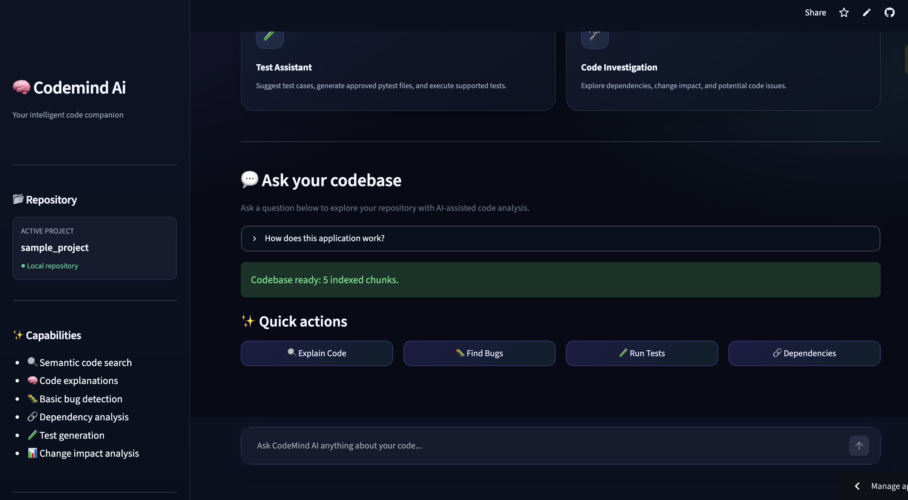
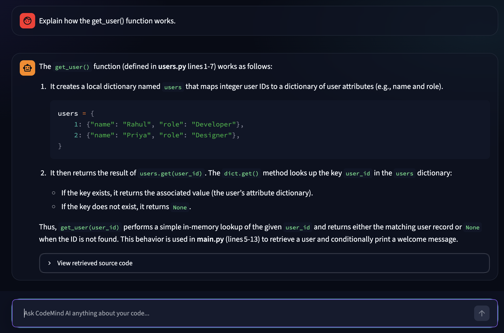

<div align="center">

# 🧠 CodeMind AI

### AI-Powered Code Intelligence & Investigation Assistant

Understand codebases, investigate bugs, explore dependencies, and generate tests using AI.

<p>
  <a href="https://codemind-ai-2026.streamlit.app/">
    
  </a>
  <a href="https://github.com/basavarajasuti69/ai-knowledge-transfer-agent">
    
  </a>
</p>


</div>

---

## 📌 Overview

CodeMind AI is an AI-powered developer assistant designed to help developers understand and investigate Python codebases.

It combines retrieval-augmented generation (RAG), semantic code search, Python AST-based static analysis, and large language models to produce context-aware explanations and investigation reports.

The application provides an interactive web interface where developers can ask questions about source code, inspect function behavior, analyze dependencies, investigate potential bugs, and work with automated tests.

**Live Application:** https://codemind-ai-2026.streamlit.app/

---

## 📸 Screenshots

### 🖥️ CodeMind AI Dashboard

Explore the dark-themed interface, repository information, and interactive quick actions.



### 🧠 AI-Powered Code Explanation

CodeMind AI explains the implementation of `get_user()`, including dictionary lookups, return values, and handling unknown user IDs.



---

## 🌐 Live Demo

Try CodeMind AI here:

**[Launch CodeMind AI](https://codemind-ai-2026.streamlit.app/)**

**[View Source Code on GitHub](https://github.com/basavarajasuti69/ai-knowledge-transfer-agent)**

---

## ✨ Features

### 🔍 Semantic Code Search
- Retrieve relevant source-code snippets using vector similarity.
- Provide repository context to the language model.
- Support questions about code structure and implementation.

### 🧠 AI-Powered Code Explanation
- Explain functions and their behavior.
- Investigate questions using retrieved source code.
- Distinguish verified implementation details from assumptions.

### 🐛 Bug Investigation
- Analyze source code for potential issues.
- Separate confirmed findings from possible risks.
- Suggest appropriate verification steps.

### 🔗 Dependency Analysis
- Explore function relationships and dependencies.
- Investigate callers and potential change impact.

### 🧪 Test Assistance
- Generate tests for supported functions.
- Execute approved generated tests.
- Explain test failures using actual pytest output.

### 💻 Interactive Web Interface
- Dark-themed Streamlit interface.
- Quick prompts for common developer tasks.
- Chat-based interaction with the codebase.

---

## 🏗️ Architecture

```text
                 ┌────────────────────────┐
                 │       Developer       │
                 └───────────┬────────────┘
                             │
                             ▼
                 ┌────────────────────────┐
                 │   Streamlit Frontend   │
                 │      CodeMind AI       │
                 └───────────┬────────────┘
                             │
                             ▼
                 ┌────────────────────────┐
                 │   Question Processing  │
                 │  & Feature Routing     │
                 └───────────┬────────────┘
                             │
                 ┌───────────┴────────────┐
                 ▼                        ▼
       ┌──────────────────┐     ┌──────────────────┐
       │   RAG Retrieval   │     │   Code Analyzer  │
       │     ChromaDB      │     │   Python AST     │
       └────────┬─────────┘     └────────┬─────────┘
                │                        │
                └────────────┬───────────┘
                             │
                             ▼
                 ┌────────────────────────┐
                 │    AI Model Provider   │
                 │ Groq API / Local Ollama│
                 └───────────┬────────────┘
                             │
                             ▼
                 ┌────────────────────────┐
                 │  Contextual Response   │
                 └────────────────────────┘
```

---

## 🛠️ Technology Stack

| Category | Technologies |
|---|---|
| Programming language | Python |
| Frontend | Streamlit |
| AI inference | Groq API, Ollama |
| Retrieval-augmented generation | RAG |
| Vector database | ChromaDB |
| Embeddings | Sentence Transformers |
| Static analysis | Python AST |
| Testing | Pytest |
| Version control | Git and GitHub |
| Deployment | Streamlit Community Cloud |

---

## 📂 Project Structure

```text
ai-knowledge-transfer-agent/
│
├── streamlit_app.py
├── app.py
├── rag_engine.py
├── code_analyzer.py
├── requirements.txt
├── README.md
│
├── .streamlit/
│   └── config.toml
│
├── sample_project/
│   ├── main.py
│   ├── users.py
│   └── database.py
│
└── tests/
    ├── test_users.py
    ├── test_database.py
    ├── test_get_user_generated.py
    └── test_connect_database_generated.py
```

---

## ⚙️ Run Locally

### 1. Clone the repository

```bash
git clone https://github.com/basavarajasuti69/ai-knowledge-transfer-agent.git
cd ai-knowledge-transfer-agent
```

### 2. Create a virtual environment

```bash
python3 -m venv .venv
```

Activate it on macOS or Linux:

```bash
source .venv/bin/activate
```

### 3. Install dependencies

```bash
python -m pip install -r requirements.txt
```

### 4. Configure the AI provider

#### Option A: Use Groq API

Create an API key through the Groq Console.

Configure your environment variables:

```bash
export AI_PROVIDER="groq"
export GROQ_MODEL="openai/gpt-oss-120b"
export GROQ_API_KEY="your_groq_api_key"
```

Use your own valid API key. Never commit API keys to GitHub.

#### Option B: Use local Ollama

Install Ollama and download the model:

```bash
ollama pull llama3.2:1b
```

Set the provider:

```bash
export AI_PROVIDER="ollama"
export LLM_MODEL="llama3.2:1b"
```

Ensure the Ollama service is running before starting the application.

### 5. Launch the application

```bash
python -m streamlit run streamlit_app.py
```

Open the local address displayed in your terminal, usually:

```text
http://localhost:8501
```

---

## 🧪 Run Tests

Execute the project test suite:

```bash
python -m pytest -v
```

The current sample-project test suite contains 12 tests.

**Latest local test result:** 12 passed.

---

## ☁️ Deployment

The application is deployed using Streamlit Community Cloud.

The hosted version uses Groq API for language-model inference, while local development can use Ollama.

Deployment requires configuring the appropriate environment variables or Streamlit secrets.

Do not store API keys in source code or commit them to the repository.

---

## 🔒 Security and Limitations

- The included repository is a demonstration project.
- Static analysis and AI-generated findings should be reviewed by a developer.
- Test generation is currently supported only for specific functions.
- The sample database function prints a message and does not establish a real database connection.
- Hosted inference is subject to the provider's current model availability, rate limits, and usage policies.
- Never submit confidential source code or secrets to an external AI provider without authorization.

---

## 🚀 Future Improvements

- Support for additional programming languages.
- Repository upload and indexing.
- More comprehensive static analysis.
- Improved test generation and coverage reporting.
- Repository-level metrics and code quality insights.
- Additional model providers.
- Authentication and user-specific project workspaces.

---

## 👨‍💻 Author

**Basavaraj Asuti**

Electronics and Communication Engineering graduate interested in AI engineering, generative AI, data engineering, and cloud technologies.

- GitHub: https://github.com/basavarajasuti69
- Project Repository: https://github.com/basavarajasuti69/ai-knowledge-transfer-agent
- Live Demo: https://codemind-ai-2026.streamlit.app/

---

<div align="center">

**Built with Python, RAG, static analysis, and LLMs.**

</div>